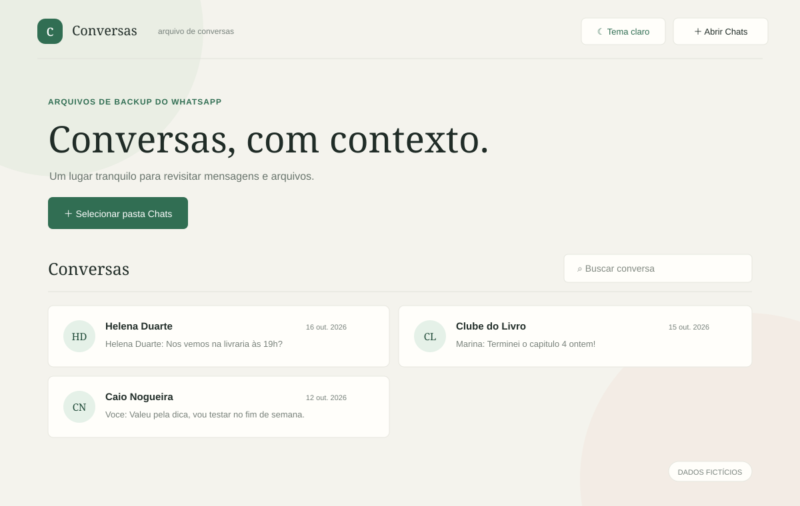
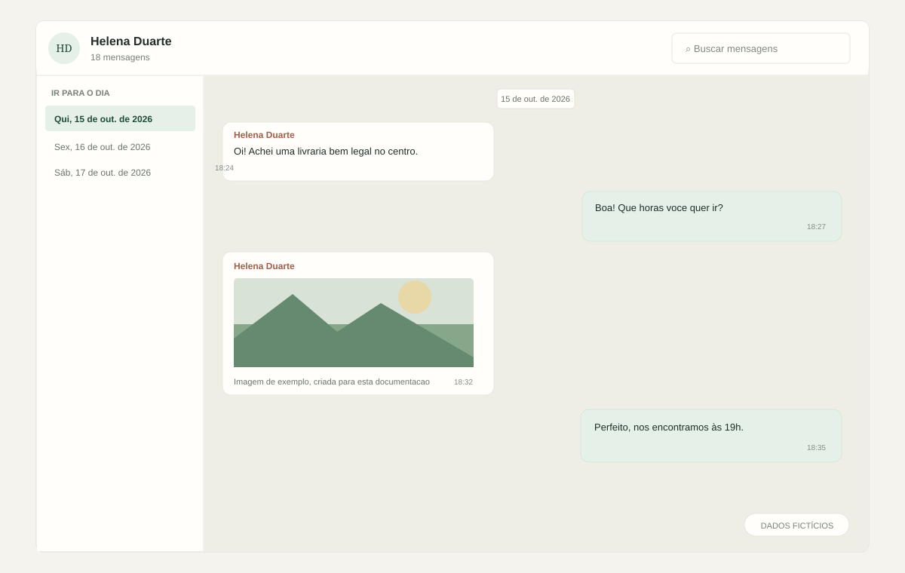

# Conversas

Visualizador local de conversas exportadas do WhatsApp. O projeto roda diretamente no navegador: não precisa de instalação, dependências ou servidor.



> As telas acima são ilustrativas. Os nomes, datas e trechos de conversa são fictícios.

## Recursos

- Lista de conversas encontrada na pasta selecionada, com busca por nome e mensagem recente.
- Mensagens em baloes, organizadas por data e hora.
- Indice lateral por dia para navegar pelo historico. No celular, o indice vira uma faixa horizontal.
- Busca dentro da conversa e carregamento progressivo de mensagens antigas.
- Imagens exibidas no chat e em um visualizador com zoom, pan por arraste e download.
- Reprodução inline de imagens, vídeos e áudios compatíveis com o navegador.
- Links para baixar documentos e outros anexos.
- Temas claro e escuro, com a preferencia salva neste navegador.



## Como usar

1. Coloque as pastas exportadas das conversas dentro de `Chats/`.
2. Abra `index.html` em um navegador com suporte a selecao de pastas. Chrome ou Edge sao boas opcoes.
3. Na tela inicial, selecione a pasta `Chats`.
4. Escolha uma conversa para abrir o histórico.

Não há etapa de build nem envio dos arquivos para um servidor. A leitura e a exibição acontecem localmente no navegador.

## Estrutura esperada

Cada conversa deve ter o arquivo de texto exportado junto com os anexos. Exports do iOS usam `_chat.txt`; exports do Android podem usar o nome da conversa, como no exemplo abaixo:

```text
Chats/
  WhatsApp Chat - Ana Exemplo/
    WhatsApp Chat - Ana Exemplo.txt
    000001-PHOTO-2026-01-10-12-30-00.jpg
    000002-AUDIO-2026-01-10-12-32-00.opus
```

O nome `Ana Exemplo` e os arquivos acima são apenas exemplos fictícios.

O leitor reconhece os formatos de exportação do iOS (`[dd/mm/aaaa, hh:mm:ss]`) e do Android (`dd/mm/aaaa hh:mm -`), incluindo anexos marcados como `<anexado: nome-do-arquivo>` ou `(arquivo anexado)`. O nome do anexo no texto precisa corresponder ao arquivo presente na pasta.

## Tipos de arquivo

- Imagens: JPG, JPEG, PNG, GIF, WebP e BMP.
- Videos: MP4, MOV, WebM e M4V.
- Audios: OPUS, OGG, MP3, M4A, AAC e WAV.
- Outros formatos: apresentados como links para download.

A reprodução de áudio e vídeo depende dos codecs suportados pelo navegador.

## Privacidade e Git

O visualizador não envia nem sincroniza as conversas. O seletor do navegador concede acesso aos arquivos escolhidos para que a página possa lê-los localmente.

A pasta `/Chats/` está listada no `.gitignore`, portanto os exports e anexos não entram no versionamento por padrão. O `.gitignore` não remove arquivos que já tenham sido commitados anteriormente; confira o histórico antes de publicar um repositório que já contenha dados pessoais.

## Compatibilidade

A página usa o seletor de diretório do navegador (`webkitdirectory`). O suporte varia entre navegadores. Áudio e vídeo também dependem dos codecs disponíveis no dispositivo.
